<p align="center">
  <picture>
    <source media="(prefers-color-scheme: dark)" srcset="docs/images/hero-dark.png">
    <source media="(prefers-color-scheme: light)" srcset="docs/images/hero-light.png">
    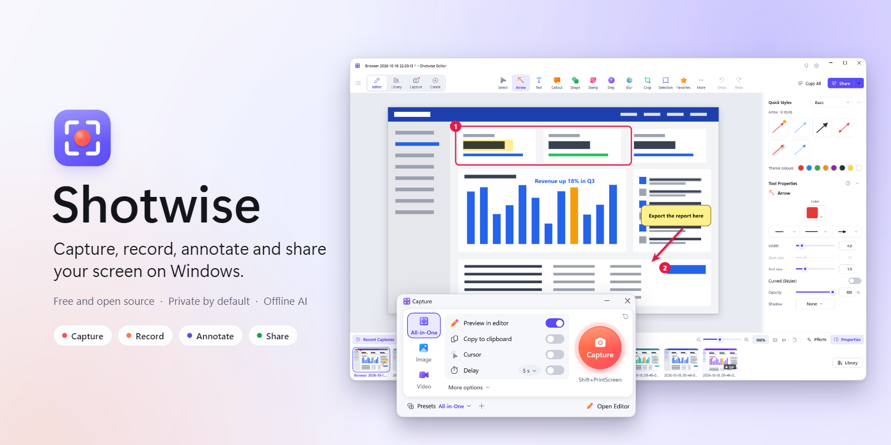
  </picture>
</p>

<p align="center">
  <b>Free, open-source screen capture, recording and annotation for Windows.</b><br>
  One hotkey to grab anything on screen, a fast editor to explain it, and private, offline AI to clean it up before you share.
</p>

<p align="center">
  <a href="https://github.com/yarink80/Shotwise/releases/latest"></a>
  <a href="https://github.com/yarink80/Shotwise/actions/workflows/ci.yml"></a>
  <a href="LICENSE"></a>
  
  
  <a href="https://github.com/yarink80/Shotwise/releases"></a>
</p>

<p align="center">
  <a href="https://github.com/yarink80/Shotwise/releases/latest"></a>
</p>

<p align="center">
  <a href="#features">Features</a> ·
  <a href="#keyboard-shortcuts">Shortcuts</a> ·
  <a href="#install-update-and-uninstall">Install</a> ·
  <a href="#build-from-source">Build</a> ·
  <a href="#how-it-works">How it works</a> ·
  <a href="#privacy-and-security">Privacy</a> ·
  <a href="#roadmap">Roadmap</a>
</p>

---

## See it in action

<p align="center">
  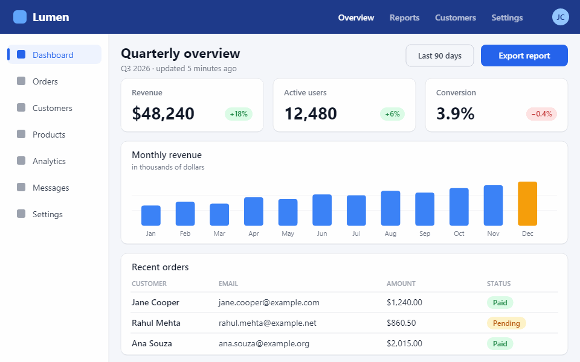
</p>

<p align="center"><sub>Every frame above is a real Shotwise document drawn by Shotwise's own renderer and encoded with its built-in GIF encoder
(<a href="tools/readme-assets">tools/readme-assets</a>).</sub></p>

## Why Shotwise

- **One key, any capture.** Press <kbd>PrintScreen</kbd>, then click a window, drag a region or pick a monitor and choose image, video, scrolling, panorama or text.
- **Explain it fast.** Arrows, callouts, numbered steps, blur, 2,600+ stamps, Quick Styles and templates, all editable until you flatten.
- **Clean it up with on-device AI.** Smart Redact hides e-mails, phone numbers, cards and faces; Grab Text copies text out of any pixel; Smart Move and Simplify restyle UI screenshots. Nothing leaves your PC.
- **Record, trim, share.** H.264 MP4 with microphone, system audio and webcam; trim and cut; export a GIF; send to a file, the clipboard, an e-mail or your own cloud accounts.
- **Light on your machine.** A single process that sits in the tray with about 190 MB working set and no background services.
- **Yours.** MIT licensed, no account, no telemetry by default, no ads.

## Features

### Capture

<table>
  <tr>
    <td width="50%">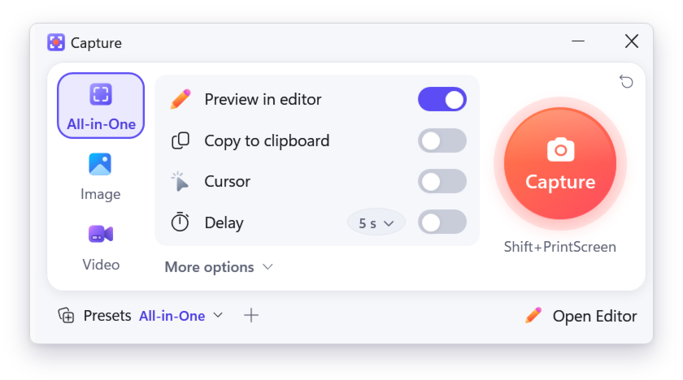</td>
    <td width="50%">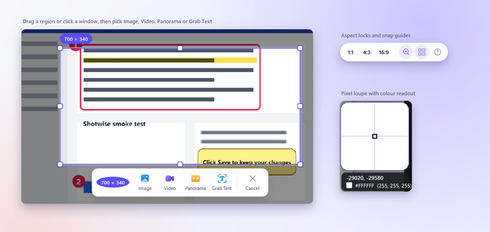</td>
  </tr>
</table>

| | |
|---|---|
| **All-in-One** | One hotkey shows a crosshair on every monitor. Click a window or UI element, drag a region or take the whole screen, then choose Image, Video, Panorama or Grab Text from the bar next to the selection. |
| **Selection types** | Region, window, fullscreen (one or all monitors), fixed size, freehand lasso, UI element, multiple areas combined into one image, cascading menus, clipboard and file import. |
| **Long pages** | Automatic scrolling capture (vertical, horizontal or both, with sticky-header removal) and manual panoramic capture with a live stitched preview. |
| **Step capture** | Records your clicks across apps; every click becomes a numbered step in a ready-made step guide. |
| **Precise** | Pixel loupe with colour readout, 1 px arrow-key nudging, 1:1 / 4:3 / 16:9 locks, snap guides, per-monitor DPI and HDR monitors (tone-mapped to SDR). |
| **Timed and automatic** | Delay with countdown, interval repeat and scheduled captures. Presets bundle mode, selection, timing, cursor, effects and outputs, each with its own hotkey. |
| **Everywhere** | Tray icon, edge-docked capture widget, Start menu, `Shotwise.exe --capture=<preset>` and a virtual printer that turns printed pages into images. |

### Recording

<p align="center">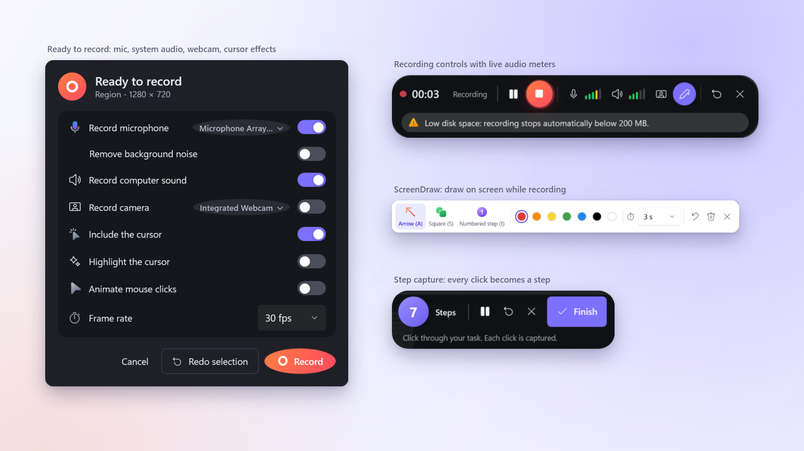</p>

- **MP4 (H.264 + AAC)** of a region, window or screen, hardware-accelerated through Media Foundation, 5 to 60 fps.
- **Microphone and system audio** mixed into one track, with live meters and a muted-mic warning.
- **Webcam picture-in-picture** (circle or rounded shapes, any corner) and a fullscreen-webcam toggle while recording.
- **Cursor effects:** highlight ring and click animations rendered into the video.
- **ScreenDraw:** draw arrows, boxes and numbered steps on screen while you record; they fade out on their own.
- **GIF recording** and **video from images**: narrate a set of stills into an MP4.
- Pause, resume, restart and a disk-space guard that stops before your drive fills up.

### Editor

<picture>
  <source media="(prefers-color-scheme: dark)" srcset="docs/images/editor-dark.png">
  <source media="(prefers-color-scheme: light)" srcset="docs/images/editor-light.png">
  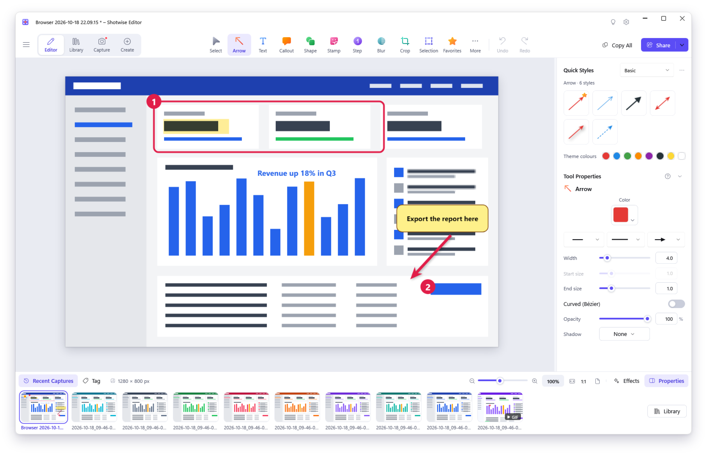
</picture>

| | |
|---|---|
| **Tools** | Arrow, line, shape, callout, text, stamp, numbered steps, pen, highlighter, fill, eraser, magnify lens, blur and pixelate, crop, cut out, pixel selection, magic wand and cursor. |
| **Quick Styles and themes** | Every tool remembers its styles; themes bundle styles, colours and font; star favourites and share themes as files. |
| **Templates** | Step guides, comparisons, before/after and grids with drop zones; combine several captures into one image. |
| **Smart Move** | Detects buttons, icons and text blocks in a flat screenshot so you can move, resize or delete them; the background is filled in automatically. |
| **Simplify** | Turns a busy UI screenshot into a clean, on-brand diagram in one click. |
| **Edit Text** | Recognises text in the image and makes it editable in a matching style. |
| **Everything stays editable** | Unlimited undo, layers you can regroup and reorder, and `.shotx` files that keep every annotation. Opens PNG, JPEG, GIF, TIFF, WebP, PDF pages, MP4 and `.snagx` files. |

<table>
  <tr>
    <td width="50%">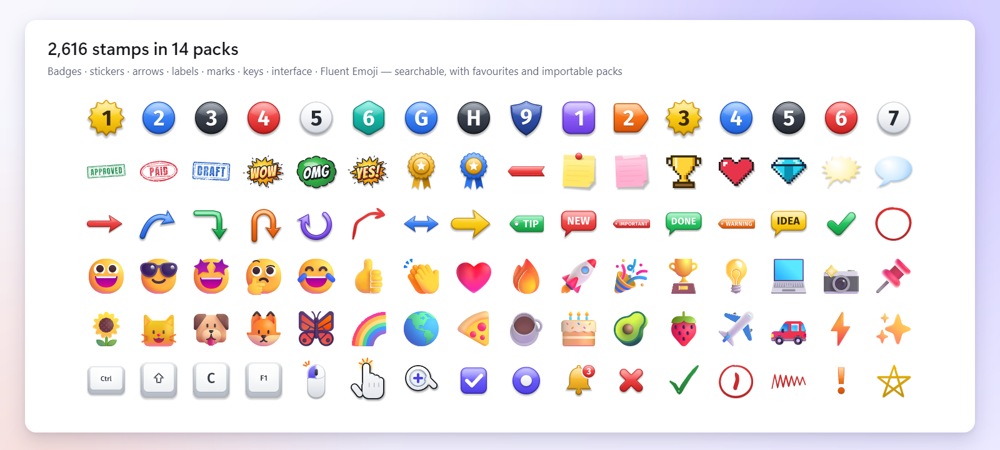</td>
    <td width="50%">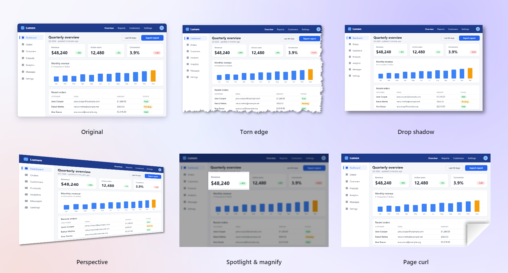</td>
  </tr>
  <tr>
    <td><b>2,600+ stamps in 14 packs.</b> Numbered badges, rubber stamps, stickers, arrows, labels, hand-drawn marks, keyboard keys,
    mouse and gesture icons, UI parts and 1,595 Fluent Emoji. Searchable, with favourites and importable packs.</td>
    <td><b>Effects.</b> Borders, torn and wavy edges, shadows, perspective, page curl, spotlight and magnify, colour adjustment,
    filters, watermarks and capture-info captions. Save combinations as Quick Effects or apply them automatically to every capture.</td>
  </tr>
</table>

### Private, on-device AI

<p align="center">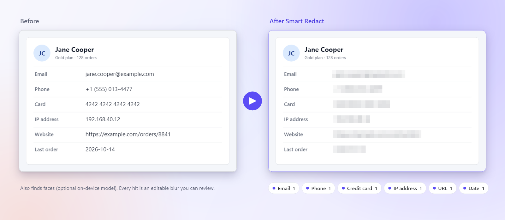</p>
<p align="center">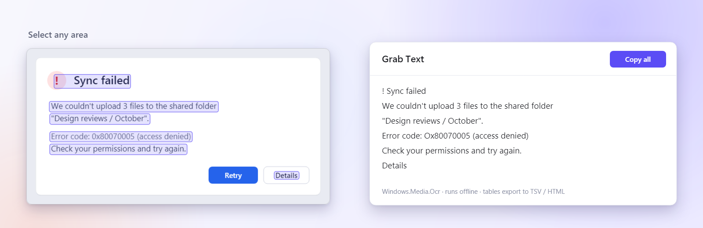</p>

- **Smart Redact** finds e-mail addresses, phone numbers, card numbers (checksum-verified), ID numbers, IP addresses, URLs, dates and faces, and turns each hit into a blur you can review.
- **Grab Text (OCR)** copies text from any region or image using Windows' built-in OCR; tables can be copied as TSV or HTML. New captures are indexed in the background so you can search their text.
- Runs offline. The optional face detector and high-quality inpainting models are downloaded only when you ask, verified by SHA-256 and shown with their licences.

### Library

<p align="center">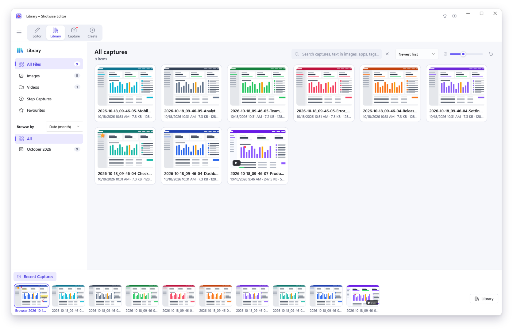</p>

- **Autosave** for every capture and recording, in a normal folder you choose (a synced cloud folder works too).
- **Search everything:** file name, app, window title, web address, annotation text and the text *inside* images (SQLite FTS5 full-text search).
- **Browse** by date, app, website, type or tag; favourites, share history with links, backup and restore to a single archive.

### Video and GIF

<p align="center">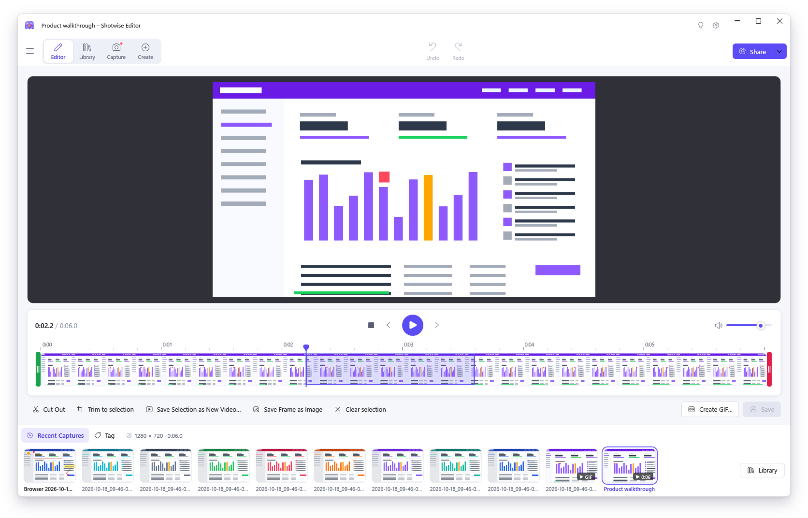</p>

Frame-accurate trimming and cutting, save a selection as a new video or a frame as an image, combine clips, and create GIFs
with presets, dithering, looping and fade to black. Animated GIFs open as videos too.

### Share

| Destination | Notes |
|---|---|
| **File** | PNG, JPEG, BMP, GIF, TIFF (multi-page), WebP, ICO, PDF (optional searchable text layer), `.shotx`, MP4 and animated GIF; automatic naming; batch convert. |
| **Clipboard, Print, E-mail** | Copy as image or HTML, print with layouts and preview, or open a ready-to-send e-mail. |
| **FTP / FTPS / SFTP, Program** | Upload to your own server or hand the file to any app. |
| **Office** | Word, Excel, PowerPoint and OneNote (the desktop apps). |
| **Cloud** | OneDrive, SharePoint, Teams, Google Drive, YouTube, Dropbox, Box, Slack, Imgur and S3-compatible storage, using **your own** app registrations (Shotwise ships no client IDs). |
| **Custom uploaders** | Point Shotwise at any HTTP endpoint with a small JSON definition. |

### Platform

- **Global hotkeys with fallback:** if another app owns <kbd>PrintScreen</kbd>, Shotwise registers <kbd>Shift</kbd>+<kbd>PrintScreen</kbd> instead and tells you once.
- **Tray, Start menu and autostart;** a second launch forwards its files to the running copy.
- **Explorer integration:** `.shotx` thumbnails and properties, "Edit in Shotwise" and `shotwise://` links for stamps, templates and themes.
- **Phone uploads:** scan a QR code to send photos and videos from your phone over your local network (off until you turn it on).
- **Automatic updates** from GitHub Releases, stable or beta channel, downloaded in the background and installed when you restart.
- **Privacy first:** no telemetry by default, no account, offline AI, credentials in Windows Credential Manager.
- **Light and dark themes,** keyboard access throughout and high-contrast support.

## Keyboard shortcuts

Global hotkeys work in every app and can be changed in **Preferences → Hotkeys**. In the editor, <kbd>Ctrl</kbd>+<kbd>/</kbd> shows every shortcut.

| Action | Default |
|---|---|
| Capture with the selected preset | <kbd>PrintScreen</kbd> (or <kbd>Shift</kbd>+<kbd>PrintScreen</kbd> when the key is taken) |
| Capture a region | <kbd>Ctrl</kbd>+<kbd>Shift</kbd>+<kbd>PrintScreen</kbd> |
| Record a video | <kbd>Alt</kbd>+<kbd>Shift</kbd>+<kbd>PrintScreen</kbd> |
| Grab Text | <kbd>Ctrl</kbd>+<kbd>Alt</kbd>+<kbd>PrintScreen</kbd> |
| Repeat the last capture | <kbd>Ctrl</kbd>+<kbd>Shift</kbd>+<kbd>F11</kbd> |
| Start, pause or resume a recording | <kbd>Ctrl</kbd>+<kbd>Shift</kbd>+<kbd>F9</kbd> |
| Stop a recording | <kbd>Ctrl</kbd>+<kbd>Shift</kbd>+<kbd>F10</kbd> |
| ScreenDraw on or off (while recording) | <kbd>Ctrl</kbd>+<kbd>Shift</kbd>+<kbd>F8</kbd> |
| Webcam fullscreen or picture-in-picture (while recording) | <kbd>Ctrl</kbd>+<kbd>Shift</kbd>+<kbd>F</kbd> |

<details>
<summary><b>Editor shortcuts and the Preferences page</b></summary>
<br>

| Action | Shortcut |
|---|---|
| All keyboard shortcuts | <kbd>Ctrl</kbd>+<kbd>/</kbd> |
| New image / new from clipboard | <kbd>Ctrl</kbd>+<kbd>N</kbd> / <kbd>Ctrl</kbd>+<kbd>Shift</kbd>+<kbd>N</kbd> |
| Open / Save / Save As | <kbd>Ctrl</kbd>+<kbd>O</kbd> / <kbd>Ctrl</kbd>+<kbd>S</kbd> / <kbd>Ctrl</kbd>+<kbd>Shift</kbd>+<kbd>S</kbd> |
| Create image from template | <kbd>Ctrl</kbd>+<kbd>Alt</kbd>+<kbd>T</kbd> |
| Combine images / combine videos | <kbd>Ctrl</kbd>+<kbd>Alt</kbd>+<kbd>C</kbd> / <kbd>Ctrl</kbd>+<kbd>Shift</kbd>+<kbd>V</kbd> |
| Undo / Redo | <kbd>Ctrl</kbd>+<kbd>Z</kbd> / <kbd>Ctrl</kbd>+<kbd>Y</kbd> |
| Flatten / flatten all | <kbd>Ctrl</kbd>+<kbd>T</kbd> / <kbd>Ctrl</kbd>+<kbd>Shift</kbd>+<kbd>T</kbd> |
| Group / ungroup | <kbd>Ctrl</kbd>+<kbd>Shift</kbd>+<kbd>G</kbd> / <kbd>Ctrl</kbd>+<kbd>Shift</kbd>+<kbd>U</kbd> |
| Zoom in / out | <kbd>Ctrl</kbd>+<kbd>+</kbd> / <kbd>Ctrl</kbd>+<kbd>-</kbd> |
| Canvas snapping | <kbd>Ctrl</kbd>+<kbd>;</kbd> |
| Duplicate / rename / pin | <kbd>Ctrl</kbd>+<kbd>Shift</kbd>+<kbd>D</kbd> / <kbd>F2</kbd> / <kbd>Ctrl</kbd>+<kbd>Shift</kbd>+<kbd>P</kbd> |
| Close / move to Recycle Bin | <kbd>Ctrl</kbd>+<kbd>F4</kbd> / <kbd>Ctrl</kbd>+<kbd>Del</kbd> |

<table>
  <tr>
    <td width="50%">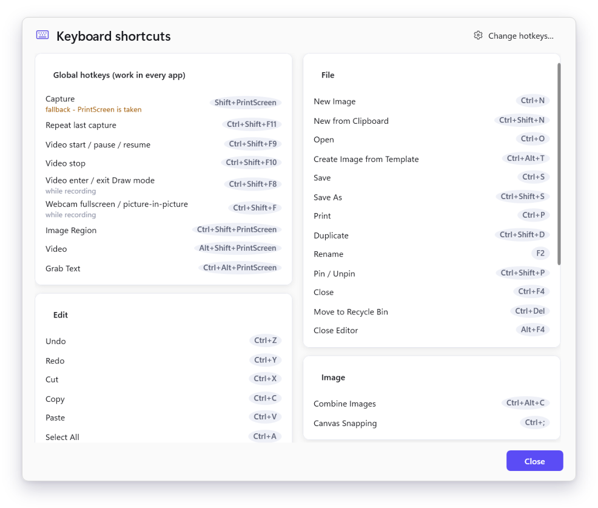</td>
    <td width="50%">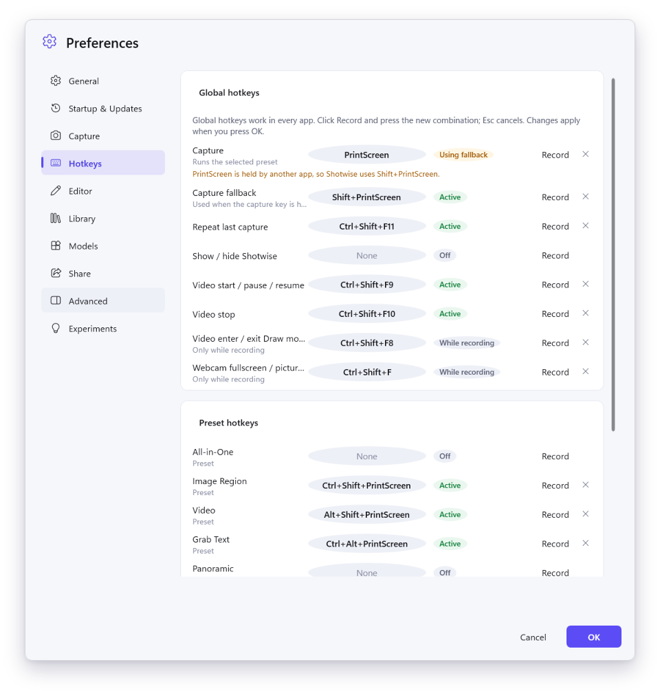</td>
  </tr>
</table>
</details>

## Install, update and uninstall

**Requirements:** Windows 10 version 2004 (build 19041) or later, or Windows 11, 64-bit. About 650 MB of disk space.
No administrator rights, no separate .NET install.

1. Download **`Shotwise-Setup.exe`** from the [latest release](https://github.com/yarink80/Shotwise/releases/latest)
   (a portable zip and `SHA256SUMS.txt` are attached too).
2. Run it. It installs for your user only in a few seconds, into `%LOCALAPPDATA%\Shotwise.App`, and starts Shotwise.
3. Press <kbd>PrintScreen</kbd> and drag over something.

> [!NOTE]
> Releases are not code-signed yet, so Windows SmartScreen may show **"Windows protected your PC"**. Click **More info → Run anyway**.
> You can check the download with `Get-FileHash .\Shotwise-Setup.exe -Algorithm SHA256` against `SHA256SUMS.txt`.

**Updates.** Installed copies check GitHub Releases once a day, download updates in the background (never on a metered
connection) and install them when you restart Shotwise. Choose the stable or beta channel, change the schedule or turn updates
off in **Preferences → Startup & Updates**. You can also simply run a newer `Shotwise-Setup.exe` over the old one.

**Uninstall.** **Settings → Apps → Installed apps → Shotwise → Uninstall.** This removes the program, its shortcuts, file types
and Explorer integration, and **keeps your captures and settings**. To remove those too, delete `Documents\Shotwise`,
`%APPDATA%\Shotwise` and `%LOCALAPPDATA%\Shotwise`.

More detail for first-time users: [docs/INSTALL.md](docs/INSTALL.md).

## How it works

Shotwise is a single .NET 8 process. A pure model library defines the document, annotations, effects and every service
contract; engine libraries implement those contracts and never reference each other; WPF libraries provide the UI; the app
project wires everything together with dependency injection.

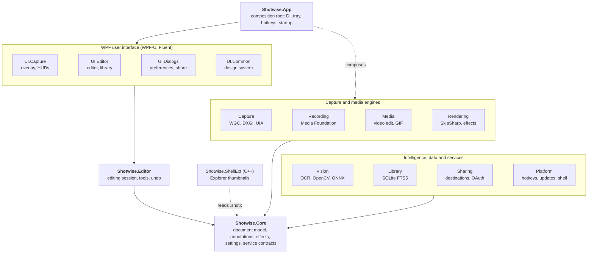

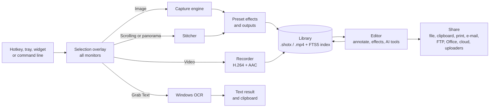

### Tech stack

| Area | Technology |
|---|---|
| App and UI | .NET 8, C# 12, WPF, [WPF-UI](https://github.com/lepoco/wpfui) Fluent controls, CommunityToolkit.Mvvm, H.NotifyIcon |
| Icons and emoji | [Fluent UI System Icons](https://github.com/microsoft/fluentui-system-icons) and [Fluent Emoji](https://github.com/microsoft/fluentui-emoji) (MIT) |
| Rendering | SkiaSharp + HarfBuzz, Svg.Skia, PDFsharp 6 (MIT line), WIC |
| Screen capture | Windows.Graphics.Capture, DXGI Desktop Duplication, GDI fallback, UI Automation, Direct2D HDR tone mapping (Vortice, CsWin32) |
| Recording and video | Media Foundation (H.264 / AAC, hardware encoding), NAudio (WASAPI mic and loopback), own GIF encoder and decoder |
| Vision and AI | Windows.Media.Ocr, OpenCvSharp4 (inpainting, stitching, detection), ONNX Runtime (optional YuNet faces, LaMa inpainting) |
| Library | SQLite with FTS5 full-text search (Microsoft.Data.Sqlite) |
| Sharing | MSAL, FluentFTP, SSH.NET, MimeKit, REST over HttpClient with PKCE loopback OAuth, own S3 SigV4 |
| Platform | Velopack installer and updates, Windows toast notifications, QRCoder, Kestrel (phone uploads), C++20 shell extension |
| Tests | xUnit, about 1,000 unit tests across Core, Editor, Rendering, Vision, Media, Library, Sharing, Platform and Recording |

## Build from source

**Prerequisites:** Windows 10/11 x64, the [.NET 8 SDK](https://dotnet.microsoft.com/download/dotnet/8.0) (8.0.4xx), and the
**Visual Studio 2022 Build Tools** with the C++ workload (MSVC v143) for the Explorer shell extension. Everything else is restored
from NuGet.

```powershell
git clone https://github.com/yarink80/Shotwise.git
cd Shotwise

powershell -File tools/build.ps1 -Test        # build the solution + native shell extension, run every test project
powershell -File tools/run.ps1 -Isolated      # run with a throw-away data root (your real profile is not touched)
powershell -File tools/package.ps1            # self-contained Release + Velopack installer -> dist\<version>\
powershell -File tools/release.ps1 -Version 0.9.1 -Publish   # bump, test, package (+delta), publish the GitHub release
```

<details>
<summary><b>More build, run and packaging options</b></summary>
<br>

- `tools/build.ps1 -Configuration Release -Native` builds Release including the shell extension.
- `tools/run.ps1 -Isolated -- --background` starts tray-only.
- Command line: `Shotwise.exe [files…] [--capture[=<preset name or id>]] [--editor] [--background]`. A second instance forwards its arguments to the running one.
- Automated smoke run: with `SHOTWISE_DATA_ROOT` set, `Shotwise.exe --smoke [--smoke-out=DIR] [--smoke-screenshots=DIR]` drives capture, editor, library, export, recording and GIF creation and writes `smoke-results.md` (details in [docs/SMOKE-TEST.md](docs/SMOKE-TEST.md)).
- `tools/package.ps1 -Version 0.9.1 -SignParams '<signtool args>'` (or `-AzureTrustedSignFile`) signs every binary, `Update.exe` and `Setup.exe`.
- Releasing: the version lives only in `Directory.Build.props`; notes go in `docs/RELEASE-NOTES-<version>.md`. Either run `tools/release.ps1 -Version x.y.z -Publish` (add `-Channel beta` with an `x.y.z-beta.N` version for a pre-release), or commit and push tag `vx.y.z` and let `.github/workflows/release.yml` build, test and publish it. `ci.yml` builds and tests every push and pull request. How updates reach users, local update testing (`SHOTWISE_UPDATE_SOURCE`) and the trust model: [docs/UPDATES.md](docs/UPDATES.md).
- MSBuild runs with `-m:1 -nodeReuse:false` to keep memory use low.
- Data locations: settings, presets and themes in `%APPDATA%\Shotwise`; catalog, thumbnails, logs and models in `%LOCALAPPDATA%\Shotwise`; library files in `Documents\Shotwise\Library`. `SHOTWISE_DATA_ROOT` redirects all of them.
- The README images are generated by `dotnet run -c Release --project tools/readme-assets`.

</details>

<details>
<summary><b>Setting up cloud share destinations</b></summary>
<br>

Shotwise ships **no** OAuth client IDs. Register your own app with each service, then enter it in **Preferences → Share → Accounts**:

1. Enter the client ID. It is stored per provider: `microsoft` covers OneDrive, SharePoint and Teams; `google` covers Drive and YouTube; the others are `dropbox`, `box`, `imgur` and `x`.
2. Enter the client secret if the provider needs one (Google desktop clients, Box, Imgur account mode). It is kept only in Windows Credential Manager.
3. Dropbox, Box, Imgur and X only accept redirect URIs registered in advance: set the **Redirect port** (default 53682) and register `http://127.0.0.1:<port>/` in that provider's developer console.
4. Click **Sign in**. Tokens are stored in Credential Manager; settings files never contain secrets.

Slack uses a pasted bot or user token. S3, FTP/SFTP and custom uploaders are configured in each destination's options.
</details>

### Project layout

```text
Shotwise/
├─ src/
│  ├─ Shotwise.App/          composition root, tray, install hooks, built-in stamps, templates, themes
│  ├─ Shotwise.Core/         document model, annotations, effects, settings, service contracts (no UI, no Windows APIs)
│  ├─ Shotwise.Editor/       editing session, tool controllers, selection, undo
│  ├─ Shotwise.Rendering/    Skia renderer, effects, image codecs, PDF export
│  ├─ Shotwise.Capture/      screen, window, element, scrolling, menu and step capture
│  ├─ Shotwise.Recording/    video recorder, audio, webcam, cursor effects
│  ├─ Shotwise.Media/        video editing, GIF encoder and decoder
│  ├─ Shotwise.Vision/       OCR, Smart Redact, Smart Move, Simplify, inpainting, stitching
│  ├─ Shotwise.Library/      SQLite catalog, autosave, tags, backup
│  ├─ Shotwise.Sharing/      share destinations, credentials, OAuth
│  ├─ Shotwise.Platform/     hotkeys, single instance, shell integration, updates, phone uploads
│  └─ Shotwise.UI.*/         WPF: Common (design system), Capture, Editor, Dialogs
├─ native/Shotwise.ShellExt/  C++ Explorer thumbnail and property handler for .shotx
├─ tests/                     xUnit test projects, one per library
├─ tools/                     build, run, package and release scripts; icon, stamp and README-image generators
└─ docs/                      install guide, release notes, architecture, feature spec, design system, smoke test, images
```

## Privacy and security

- **No telemetry by default.** Usage data is off and opt-in only; there is no analytics endpoint in the app. Crash information stays in local log files.
- **Your captures stay local** until you share them. The library is a normal folder plus a local SQLite index.
- **AI runs on your PC.** OCR uses Windows' built-in engine; OpenCV and ONNX models run locally. Optional models are downloaded only on request and verified by SHA-256.
- **The only automatic network call is the update check** against this repository's GitHub Releases, which you can switch off.
- **Credentials** for share destinations live in Windows Credential Manager. OAuth uses your browser with PKCE and a loopback redirect, and Shotwise ships no client secrets.
- **Phone uploads** are off by default and use a local HTTPS server with short-lived QR pairing.
- Administrators can disable features (OCR, outputs, microphone, system audio, phone uploads, FTP, updates, telemetry) with policy keys under `HKLM\Software\Policies\Shotwise`.

Found a vulnerability? Please report it privately; see [SECURITY.md](SECURITY.md).

## Roadmap

- [ ] **Linux app** built with Avalonia, sharing the Core, Editor and engine contracts ([plan](docs/architecture/linux-roadmap.md)).
- [ ] **Multi-PC shared library** through a small self-hosted Hub: one capture history and search across your computers, originals kept on the machine you choose.
- [ ] **Code signing** for the installer and binaries, so SmartScreen stops warning.
- [ ] **Translations:** German, Spanish, French, Japanese and Brazilian Portuguese (resource stubs exist; help welcome).
- [ ] Tesseract as an optional second OCR engine and a bundled noise-suppression model for recordings.

Ideas and votes are welcome in [Issues](https://github.com/yarink80/Shotwise/issues).

## Contributing

Bug reports, feature ideas, translations and pull requests are welcome. Start with [CONTRIBUTING.md](CONTRIBUTING.md); the
issue forms ask for the details that help most.

## Credits and licences

Shotwise stands on great open-source work. Every third-party component and its licence is listed in
[THIRD-PARTY-NOTICES.md](THIRD-PARTY-NOTICES.md); licence texts are in [licenses/](licenses) and ship with the installer.

- UI icons: [Microsoft Fluent UI System Icons](https://github.com/microsoft/fluentui-system-icons) (MIT).
- Emoji stamps: [Microsoft Fluent Emoji](https://github.com/microsoft/fluentui-emoji) (MIT); localised emoji names from Unicode CLDR (Unicode License v3).
- All other stamps, templates, cursors, callout shapes, edge effects and the app icon are original artwork made for Shotwise.
- Libraries are MIT, Apache-2.0 or BSD licensed. PDFsharp is pinned to 6.2.4, its last MIT release.
- Optional AI models are not bundled. They are downloaded on demand under their own licences (YuNet: MIT, LaMa: Apache-2.0), which are shown before download.

## License

Shotwise is released under the [MIT License](LICENSE). Copyright (c) 2026 Yarin (yarink80).
